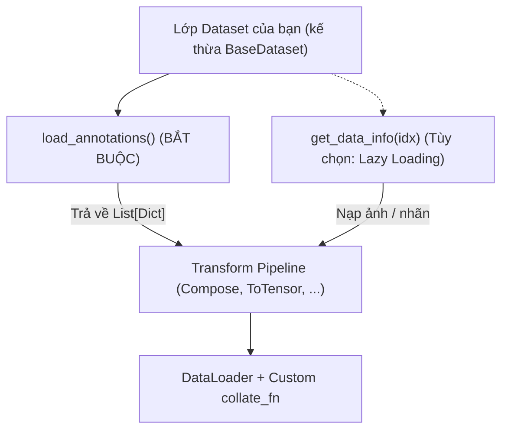

# 02. Hướng dẫn Tự Định nghĩa Dataset & Các Hàm Bổ Trợ (Helpers)

Trong `BaseModel`, triết lý cốt lõi là **tách biệt hoàn toàn logic dữ liệu bài toán khỏi hạ tầng huấn luyện**. Framework **không cung cấp các lớp Dataset cứng nhắc có sẵn** mà **bắt buộc người dùng phải tự định nghĩa** lớp Dataset riêng cho bài toán của mình bằng cách kế thừa `BaseDataset`.

Đổi lại, framework cung cấp sẵn:
1. **Lớp trừu tượng `BaseDataset`**: Quản lý vòng đời pipeline transforms, indexing và collation.
2. **Bộ hàm hỗ trợ (Dataset Helpers)**: Đọc ảnh, quét thư mục, parse CSV, đọc/ghi LMDB.
3. **Các bộ gom nhóm Batch tùy biến (Custom Collate Functions)**: `PadCollate`, `DetectionCollate`, `SmartCollate`.

---

## 1. Cơ chế hoạt động của `BaseDataset`

Khi tự định nghĩa một Dataset, bạn chỉ cần hiện thực phương thức `load_annotations()`:



* **`load_annotations(self) -> List[Dict[str, Any]]`** *(Bắt buộc)*:
  Quét dữ liệu và trả về danh sách các Dictionary mô tả từng mẫu (đường dẫn ảnh, nhãn, ID,...).
* **`get_data_info(self, idx: int) -> Dict[str, Any]`** *(Tùy chọn)*:
  Được gọi khi nạp mẫu thứ `idx`. Thích hợp khi cần **Lazy-loading** (chỉ đọc ảnh, mảng nhị phân, hoặc mask khi batch thực sự cần đến).

---

## 2. Bộ Hàm Hỗ trợ Tiện ích (`BaseModel.dataset.helpers`)

Framework cung cấp sẵn các hàm tiện ích trong `BaseModel.dataset` giúp bạn viết code nạp dữ liệu nhanh chóng và an toàn:

| Tên hàm hỗ trợ | Đầu vào | Trả về | Mục đích sử dụng |
| :--- | :--- | :--- | :--- |
| `load_image(img_input, mode='RGB')` | Đường dẫn file, bytes nhị phân, BytesIO, hoặc PIL Image | `PIL.Image` | Đọc và giải mã ảnh vạn năng, tự động chuyển về hệ màu mong muốn (`RGB`, `L`,...). |
| `find_images(folder, extensions=...)` | Đường dẫn thư mục | `List[str]` | Quét đệ quy toàn bộ thư mục và trả về danh sách đường dẫn các file ảnh hợp lệ. |
| `parse_csv(csv_path, delimiter=',')` | Đường dẫn file CSV | `List[Dict[str, str]]` | Đọc nhanh file CSV thành danh sách các dòng dictionary. |
| `open_lmdb(db_path, readonly=True)` | Thư mục LMDB | `(env, txn)` | Mở môi trường LMDB an toàn, tránh lỗi khóa file. |
| `read_lmdb_bytes(txn, key)` | Transaction & Khóa (str hoặc bytes) | `bytes` | Đọc dữ liệu nhị phân của một khóa từ LMDB. |
| `create_lmdb(samples, output_path)` | Danh sách `[(img_path, label), ...]` | `None` | Đóng gói nhanh danh sách ảnh thành cơ sở dữ liệu LMDB siêu tốc. |

---

## 3. Các Mẫu Tự Định nghĩa Dataset Phổ Biến

Dưới đây là các mẫu chuẩn giúp bạn dễ dàng tự xây dựng Dataset cho từng trường hợp:

### 3.1. Mẫu 1: Dataset đọc từ Thư mục phân loại theo lớp (Image Folder)
Sử dụng hàm hỗ trợ `find_images` và `load_image`:

```python
# projects/my_task/dataset.py
import os
from BaseModel.core import DATASETS
from BaseModel.dataset import BaseDataset, find_images, load_image

@DATASETS.register_module()
class CustomFolderDataset(BaseDataset):
    def load_annotations(self):
        classes = sorted([d for d in os.listdir(self.data_root) if os.path.isdir(os.path.join(self.data_root, d))])
        self.class_to_idx = {cls_name: i for i, cls_name in enumerate(classes)}

        data_infos = []
        for cls_name in classes:
            cls_dir = os.path.join(self.data_root, cls_name)
            target = self.class_to_idx[cls_name]
            for img_path in find_images(cls_dir):
                data_infos.append({"img_path": img_path, "target": target})
        return data_infos

    def get_data_info(self, idx: int):
        info = self.data_infos[idx].copy()
        # Nạp ảnh bằng helper load_image
        info["image"] = load_image(info["img_path"], mode="RGB")
        return info
```

---

### 3.2. Mẫu 2: Dataset đọc từ File CSV / Excel
Sử dụng hàm hỗ trợ `parse_csv`:

```python
# projects/my_task/csv_dataset.py
import os
from BaseModel.core import DATASETS
from BaseModel.dataset import BaseDataset, load_image, parse_csv

@DATASETS.register_module()
class CustomCSVDataset(BaseDataset):
    def load_annotations(self):
        rows = parse_csv(self.ann_file)
        data_infos = []
        for r in rows:
            img_path = os.path.join(self.data_root, r["filename"])
            target = int(r["label"])
            data_infos.append({"img_path": img_path, "target": target})
        return data_infos

    def get_data_info(self, idx: int):
        info = self.data_infos[idx].copy()
        info["image"] = load_image(info["img_path"], mode="RGB")
        return info
```

---

### 3.3. Mẫu 3: Dataset đọc từ Cơ sở dữ liệu LMDB (Lightning Memory-Mapped DB)
Tối ưu cho tập dữ liệu lớn hàng trăm nghìn ảnh, giải quyết nghẽn cổ chai đọc đĩa I/O:

```python
# projects/my_task/lmdb_dataset.py
from BaseModel.core import DATASETS
from BaseModel.dataset import BaseDataset, load_image, open_lmdb, read_lmdb_bytes

@DATASETS.register_module()
class CustomLMDBDataset(BaseDataset):
    def __init__(self, data_root, pipeline=None, test_mode=False):
        self.env = None
        self.txn = None
        super().__init__(data_root=data_root, pipeline=pipeline, test_mode=test_mode)

    def load_annotations(self):
        # Mở tạm thời để đọc tổng số mẫu
        env, txn = open_lmdb(self.data_root, readonly=True)
        length_bytes = txn.get(b"num-samples")
        total = int(length_bytes.decode()) if length_bytes else txn.stat()["entries"] // 2
        env.close()
        return [{"idx": i} for i in range(total)]

    def _init_db(self):
        # Lazy init an toàn với đa tiến trình (multiprocessing spawn/fork)
        if self.env is None:
            self.env, self.txn = open_lmdb(self.data_root, readonly=True)

    def get_data_info(self, idx: int):
        self._init_db()
        img_bytes = read_lmdb_bytes(self.txn, f"image-{idx:09d}")
        lbl_bytes = read_lmdb_bytes(self.txn, f"label-{idx:09d}")

        return {
            "image": load_image(img_bytes, mode="RGB"),
            "target": int(lbl_bytes.decode()) if lbl_bytes else -1
        }

    def __getstate__(self):
        state = self.__dict__.copy()
        state["env"], state["txn"] = None, None
        return state
```

---

### 3.4. Mẫu 4: Dataset Phân đoạn ảnh Semantic Segmentation
Nạp đồng thời ảnh gốc và mặt nạ (mask PNG):

```python
# projects/my_task/seg_dataset.py
import os
from BaseModel.core import DATASETS
from BaseModel.dataset import BaseDataset, find_images, load_image

@DATASETS.register_module()
class CustomSegDataset(BaseDataset):
    def load_annotations(self):
        img_dir = os.path.join(self.data_root, "images")
        mask_dir = os.path.join(self.data_root, "masks")

        data_infos = []
        for img_path in find_images(img_dir):
            stem = os.path.splitext(os.path.basename(img_path))[0]
            mask_path = os.path.join(mask_dir, f"{stem}.png")
            data_infos.append({"img_path": img_path, "mask_path": mask_path})
        return data_infos

    def get_data_info(self, idx: int):
        info = self.data_infos[idx].copy()
        info["image"] = load_image(info["img_path"], mode="RGB")
        info["mask"] = load_image(info["mask_path"], mode="L")
        info["target"] = info["mask"]
        return info
```

---

## 4. Tùy biến hàm gom nhóm Batch: Custom `collate_fn`

Khi các mẫu trong batch có kích thước không đồng nhất hoặc cấu trúc nhãn phức tạp (Bounding Boxes, Keypoints), framework cung cấp hệ thống `COLLATE_FUNCTIONS`:

### 4.1. Các Collate Functions có sẵn
1. **`SmartCollate`** *(Mặc định)*: Tự động gom tensor cùng kích thước, giữ nguyên list đối với dữ liệu độ dài thay đổi.
2. **`PadCollate`**: Tự động đệm (pad) các ảnh có kích thước khác nhau trong batch về cùng kích thước lớn nhất `(B, C, max_H, max_W)`. Có tham số `size_divisor: 32` giúp kích thước chia hết cho 32.
3. **`DetectionCollate`**: Gom nhóm ảnh thành tensor và giữ nguyên danh sách `bboxes`, `labels` cho từng ảnh.

### 4.2. Cấu hình trong file YAML
```yaml
data:
  train:
    dataset:
      type: "CustomFolderDataset"
      data_root: "./data/train"
      pipeline:
        - type: "ToTensor"
    batch_size: 16
    # Sử dụng PadCollate
    collate_fn:
      type: "PadCollate"
      pad_value: 0.0
      size_divisor: 32
```

### 4.3. Tự viết Collate Function mới
```python
import torch
from BaseModel.core.registrar import COLLATE_FUNCTIONS

@COLLATE_FUNCTIONS.register_module()
class CustomBatchCollate:
    def __call__(self, batch):
        images = torch.stack([b["image"] for b in batch], dim=0)
        targets = [b["target"] for b in batch]
        return {"image": images, "target": targets}
```
Sau đó trong file YAML chỉ cần khai báo `collate_fn: "CustomBatchCollate"`.
