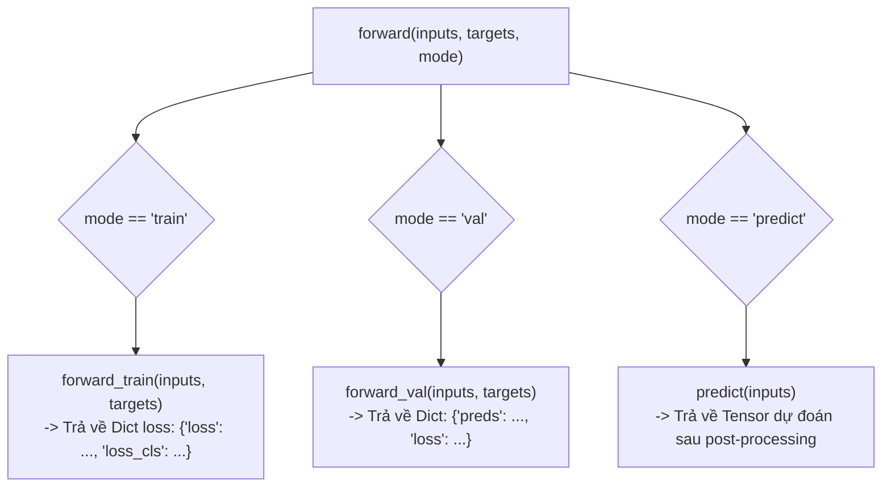

# 03. Thiết kế Mô hình & Tính Đa hình (Polymorphism)

## 1. Triết lý thiết kế `BaseModel`

Trong PyTorch thông thường, hàm `forward(self, x)` chỉ nhận tensor đầu vào và trả về logits. Điều này đòi hỏi người viết mã phải tự tay viết các bước tính loss, trích xuất dự đoán và áp dụng argmax bên ngoài vòng lặp train.

`BaseModel` giải quyết vấn đề này bằng cách thiết lập **3 hợp đồng thực thi đa hình**:



Nhờ hợp đồng đa hình này, `BaseTrainer` có thể huấn luyện bất kỳ mô hình nào (từ ResNet, Vision Transformer đến YOLO hay UNet) mà không cần quan tâm chi tiết bên trong của mô hình.

---

## 2. Các phương thức chuẩn của `BaseModel`

| Phương thức | Chức năng | Trả về |
| :--- | :--- | :--- |
| `forward_train(inputs, targets)` | *(Bắt buộc)* Chạy forward khi huấn luyện và tính toán loss. | `Dict[str, torch.Tensor]` (chứa khóa `'loss'`). |
| `forward_val(inputs, targets)` | Chạy forward khi đánh giá, tính cả predictions và validation loss. | `Dict[str, Any]` (chứa `'preds'` và `'loss'`). |
| `predict(inputs)` | *(Bắt buộc)* Chạy forward khi suy luận (inference), trả về kết quả sau post-processing. | `torch.Tensor` hoặc kết quả đã xử lý (ví dụ: bboxes sau NMS). |
| `init_weights()` | Tự động khởi tạo trọng số các lớp Conv2d (Kaiming), BatchNorm, Linear. | `None` |
| `freeze(sub_module_name)` | Đóng băng toàn bộ mạng hoặc một thành phần con (ví dụ: `backbone`). | `None` |
| `unfreeze(sub_module_name)`| Mở đóng băng toàn bộ mạng hoặc thành phần con. | `None` |

---

## 3. Ví dụ thiết kế mô hình thực tế

### 3.1. Mô hình Phân loại ảnh với Backbone tiền huấn luyện (Transfer Learning)
```python
# projects/classification/resnet_classifier.py
import torch
import torch.nn as nn
import torchvision.models as tv_models
from BaseModel.core import MODELS
from BaseModel.model import BaseModel

@MODELS.register_module()
class ResNetClassifier(BaseModel):
    def __init__(self, num_classes=10, pretrained=True, freeze_backbone=False):
        super().__init__()
        weights = tv_models.ResNet50_Weights.DEFAULT if pretrained else None
        resnet = tv_models.resnet50(weights=weights)

        # Tách Backbone và Head
        self.backbone = nn.Sequential(*list(resnet.children())[:-1])
        self.classifier = nn.Linear(resnet.fc.in_features, num_classes)
        self.loss_fn = nn.CrossEntropyLoss()

        if freeze_backbone:
            self.freeze("backbone")

    def forward_train(self, inputs, targets=None, **kwargs):
        feat = self.backbone(inputs)
        feat = torch.flatten(feat, 1)
        logits = self.classifier(feat)

        loss = self.loss_fn(logits, targets)
        return {"loss": loss, "loss_cls": loss}

    def predict(self, inputs, **kwargs):
        feat = self.backbone(inputs)
        feat = torch.flatten(feat, 1)
        logits = self.classifier(feat)
        return logits.softmax(dim=1)  # Trả về phân phối xác suất
```

### 3.2. Mô hình Đa nhiệm (Multi-task: Classification + Bounding Box Regression)
```python
# projects/detection/simple_detector.py
import torch
import torch.nn as nn
import torch.nn.functional as F
from BaseModel.core import MODELS
from BaseModel.model import BaseModel

@MODELS.register_module()
class SimpleDetector(BaseModel):
    def __init__(self, num_classes=80):
        super().__init__()
        self.backbone = nn.Sequential(...)
        self.cls_head = nn.Linear(512, num_classes)
        self.reg_head = nn.Linear(512, 4)

    def forward_train(self, inputs, targets=None, **kwargs):
        # targets: {'labels': tensor, 'bboxes': tensor}
        feat = self.backbone(inputs)
        pred_cls = self.cls_head(feat)
        pred_reg = self.reg_head(feat)

        loss_cls = F.cross_entropy(pred_cls, targets["labels"])
        loss_reg = F.smooth_l1_loss(pred_reg, targets["bboxes"])
        total_loss = loss_cls + 2.0 * loss_reg

        return {
            "loss": total_loss,
            "loss_cls": loss_cls,
            "loss_reg": loss_reg
        }

    def predict(self, inputs, **kwargs):
        feat = self.backbone(inputs)
        return {
            "scores": self.cls_head(feat).softmax(dim=-1),
            "boxes": self.reg_head(feat)
        }
```

---

## 4. Quản lý Đóng băng trọng số (Freezing)

Khi thực hiện Fine-tuning, bạn có thể dễ dàng kiểm soát gradient của các lớp:
```python
model = build_model(cfg.model)

# Đóng băng chỉ riêng phần trích xuất đặc trưng (backbone)
model.freeze("backbone")

# Huấn luyện chỉ head
# ...
# Sau 5 epochs, mở đóng băng để fine-tuning toàn bộ mạng
model.unfreeze("backbone")
```


---

## 4. Xuất toàn bộ Model & Layers vào 1 file duy nhất (Single-file Export)

Framework hỗ trợ trích xuất toàn bộ mã nguồn của model cùng toàn bộ các layers, backbones, necks, heads đã đăng ký thành một file .py độc lập (standalone):
- Tự động đóng gói tất cả các thư viện cần thiết (	orch, 	yping, math,...).
- Tự động loại bỏ decorator phụ thuộc vào Registry để file xuất ra có thể **chạy độc lập ở bất kỳ đâu** mà không cần thư mục BaseModel.

### Cách 1: Xuất trực tiếp từ instance của Model
`python
from Visdrone.model import VisDroneDetector

model = VisDroneDetector()
model.export_to_single_file('exported_visdrone.py')
`

### Cách 2: Sử dụng hàm export_model_to_single_file
`python
from BaseModel.model import export_model_to_single_file

# Gom tất cả các layer và model đã đăng ký vào một file
file_path = export_model_to_single_file(
    output_path='models/standalone_model.py',
    include_all_layers=True,
)
print('Đã xuất thành công tại:', file_path)
`
