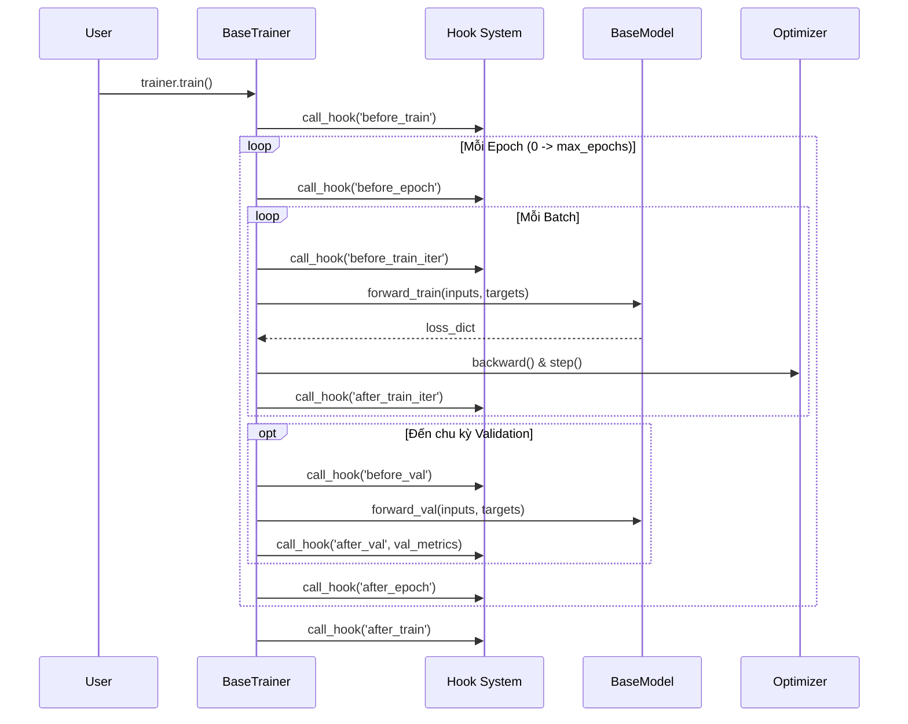

# 04. Training Engine & Hệ thống Hooks

## 1. Vòng đời huấn luyện trong `BaseTrainer`

`BaseTrainer` là trái tim điều khiển quy trình huấn luyện trong framework, áp dụng **Template Method Pattern**. Một vòng lặp huấn luyện hoàn chỉnh diễn ra như sau:



---

## 2. Các tính năng nâng cao trong `BaseTrainer`

### 2.2. Hỗ trợ Linh hoạt Phần cứng: GPU, TPU (Google PyTorch XLA), MPS, CPU
- **Chuyển đổi GPU <-> TPU**: Chỉ cần thiết lập `device: "tpu"` (hoặc qua CLI: `--device tpu`), framework tự động:
  - Khởi tạo thiết bị TPU qua `torch_xla.core.xla_model.xla_device()`.
  - Cập nhật trọng số thông qua `xm.optimizer_step(self.optimizer)` và đồng bộ `xm.mark_step()`.
  - Lưu checkpoint an toàn qua `xm.save()` tránh xung đột trên cụm TPU đa lõi.
  - Sử dụng định dạng số `bfloat16` bản địa trên TPU mà không cần Scaler phức tạp.
- **Tự động chuyển đổi thiết bị (`to_device`)**:
  Trainer tự động chuyển đổi đệ quy các tensor lồng nhau trong `dict` hoặc `list` sang target device (`cuda`, `xla/tpu`, `mps`, hoặc `cpu`), giảm thiểu hoàn toàn các lỗi `RuntimeError: Expected all tensors to be on the same device`.

### 2.3. Huấn luyện độ chính xác hỗn hợp tự động (Automatic Mixed Precision - AMP)
Khi bật `use_amp: true`, Trainer kích hoạt `torch.amp.autocast` và `GradScaler` giúp:
- Tăng tốc độ huấn luyện lên tới 2x trên các GPU dòng NVIDIA Turing / Ampere / Ada / Hopper.
- Tiết kiệm 40% dung lượng VRAM, cho phép tăng kích thước `batch_size`.

### 2.4. Cắt tỉa Gradient (Gradient Clipping)
Để tránh hiện tượng phát nổ gradient (Exploding Gradients) trong các mạng sâu (Deep CNNs) hoặc Transformers, chỉ cần cấu hình:
```yaml
train_cfg:
  grad_clip: 1.0  # Cắt tỉa chuẩn L2 tối đa là 1.0
```

---

## 3. Hệ thống Hooks (Observer Pattern)

Hooks cho phép gắn các chức năng phụ trợ vào các điểm kích hoạt (trigger points) của Trainer mà không làm rối mã nguồn chính.

### 3.1. Các Hooks tích hợp sẵn

| Tên Hook | Trách nhiệm | Tham số cấu hình chính |
| :--- | :--- | :--- |
| `LoggerHook` | Ghi log thời gian, loss, lr ra Console và File. | `interval: 20` (số iter mỗi lần log) |
| `CheckpointHook` | Tự động lưu `last.pth`, `best.pth` và checkpoint định kỳ. | `interval: 1`, `save_best: 'acc'`, `mode: 'max'` |
| `LrSchedulerHook` | Bước scheduler theo epoch hoặc theo iter. | `by_epoch: true` |
| `EarlyStoppingHook` | Tự động ngắt huấn luyện khi validation metric không tăng sau $N$ epoch. | `monitor: 'val_loss'`, `patience: 10`, `mode: 'min'` |
| `TensorboardHook` | Ghi log biểu đồ loss, lr, metrics ra thư mục TensorBoard (`tf_logs`). | `log_dir: Optional[str]` |
| `WandbHook` | Theo dõi thí nghiệm trực tuyến và đồng bộ metrics lên Weights & Biases. | `project: 'BaseModel_CV'`, `name: 'run1'` |

---

## 4. Cách viết một Custom Hook mới

Bạn có thể dễ dàng viết Hook mới (ví dụ: ghi log sang Weights & Biases hoặc gửi thông báo Telegram khi train xong) bằng cách kế thừa `BaseHook`:

```python
# custom_hooks.py
from BaseModel.core import HOOKS
from BaseModel.core.hooks import BaseHook

@HOOKS.register_module()
class TelegramNotifyHook(BaseHook):
    def __init__(self, bot_token: str, chat_id: str):
        self.bot_token = bot_token
        self.chat_id = chat_id

    def after_val(self, trainer, val_metrics):
        # Gửi thông báo metric sau mỗi lần validation
        best_acc = val_metrics.get("acc", 0.0)
        msg = f"Epoch {trainer.epoch + 1}: Val Acc = {best_acc:.2f}%"
        self._send_telegram(msg)

    def after_train(self, trainer):
        # Gửi thông báo hoàn thành huấn luyện
        self._send_telegram("Huấn luyện mô hình đã hoàn thành xuất sắc!")

    def _send_telegram(self, message):
        # Logic gọi requests.post tới Telegram Bot API
        pass
```

Khai báo Hook vừa viết trong file `config.yaml`:
```yaml
hooks:
  - type: "TelegramNotifyHook"
    bot_token: "YOUR_BOT_TOKEN"
    chat_id: "YOUR_CHAT_ID"
```
Trainer sẽ tự động nạp và kích hoạt Hook này theo đúng chu kỳ.
