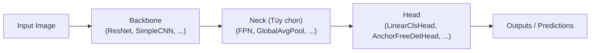

# 08. Lắp ghép Mô hình linh hoạt với `layers_module` & `ModularModel`

Trong phát triển thị giác máy tính hiện đại (tương tự thiết kế của OpenMMLab / Detectron2), việc viết lại toàn bộ class Model mỗi khi muốn đổi từ Backbone ResNet18 sang MobileNet, hoặc thêm Feature Pyramid Network (FPN) là không tối ưu.

Mô-đun [`BaseModel/model/layers_module.py`](layers_module.py) cung cấp kiến trúc **Plug-and-Play (Lắp ghép mô-đun)**:
- Cho phép bạn tách rời mô hình thành 3 khối độc lập: **`Backbone`**, **`Neck`**, **`Head`**.
- Thay đổi cấu trúc mô hình hoàn toàn **qua file YAML** mà không cần viết lại một dòng code Python nào.



---

## 1. Các thành phần có sẵn trong `layers_module`

### 1.1. Core Layers (`LAYERS`)
Các khối tầng cơ sở chất lượng cao:
- **`ConvModule`**: Tích hợp chuẩn hóa `Conv2d + Norm (BN/GN) + Activation (ReLU/SiLU/GELU)`. Tự động tính padding 'same'.
- **`DepthwiseSeparableConv`**: Tích chập tách biệt theo chiều sâu (MobileNet style) tiết kiệm FLOPS.
- **`ResidualBlock`**: Khối thặng dư với skip connection giải quyết triệt tiêu gradient.

### 1.2. Backbones (`BACKBONES`)
- **`SimpleCNNBackbone`**: Backbone CNN đa tầng tùy biến số lượng channel: `stage_channels: [32, 64, 128]`.
- **`ResNetBackbone`**: ResNet chuẩn (`depth: 18, 34, 50`) hỗ trợ trọng số `pretrained: True/False` và đóng băng tầng `frozen_stages`.

### 1.3. Necks (`NECKS`)
- **`FPN` (Feature Pyramid Network)**: Hợp nhất đặc trưng đa tỉ lệ (Multi-scale fusion) từ thấp lên cao, cực kỳ quan trọng cho bài toán phát hiện vật thể nhỏ/lớn.
- **`GlobalAvgPoolNeck`**: Thu gọn không gian `(H, W) -> 1` cho các bài toán phân loại ảnh.

### 1.4. Heads (`HEADS`)
- **`LinearClsHead`**: Đầu phân loại với Dropout và Linear layer.
- **`AnchorFreeDetHead`**: Đầu phát hiện đối tượng anchor-free dự đoán đồng thời: class probabilities, bounding boxes `[cx, cy, w, h]`, và objectness score.

---

## 2. Cách Lắp ghép trong file `config.yaml`

### Ví dụ 1: Mô hình Phân loại ảnh (ResNet18 + GlobalPool + Classifier)
```yaml
model:
  type: "ModularModel"
  
  # 1. Chọn Backbone
  backbone:
    type: "ResNetBackbone"
    depth: 18
    pretrained: true
    frozen_stages: 1       # Đóng băng stage 1 để fine-tuning
    
  # 2. Chọn Neck
  neck:
    type: "GlobalAvgPoolNeck"
    
  # 3. Chọn Head
  head:
    type: "LinearClsHead"
    in_channels: 512
    num_classes: 10
    dropout: 0.2
```

---

### Ví dụ 2: Mô hình Phát hiện đối tượng (Backbone + FPN + Detection Head)
Chỉ cần đổi cấu hình YAML:
```yaml
model:
  type: "ModularModel"
  
  # 1. Trích xuất đặc trưng đa tầng
  backbone:
    type: "ResNetBackbone"
    depth: 18
    pretrained: false
    
  # 2. Hợp nhất đặc trưng FPN
  neck:
    type: "FPN"
    in_channels: [64, 128, 256, 512]
    out_channels: 64
    
  # 3. Đầu dự đoán Bounding Box Anchor-Free
  head:
    type: "AnchorFreeDetHead"
    in_channels: 64
    num_classes: 10
```

---

## 3. Tự viết thêm Module mới vào hệ sinh thái

Bạn có thể tự định nghĩa thêm Backbone, Neck hoặc Head bất kỳ bằng cách gắn decorator tương ứng:

```python
from BaseModel.core import BACKBONES, NECKS, HEADS

@BACKBONES.register_module()
class MyCustomTransformerBackbone(nn.Module):
    def __init__(self, patch_size=16, embed_dim=256):
        super().__init__()
        ...

@NECKS.register_module()
class MyBiFPN(nn.Module):
    ...
```

Sau khi đăng ký, module mới có thể lắp ghép với bất kỳ thành phần nào khác thông qua `ModularModel`.
