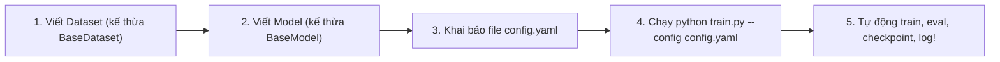

# BaseModel Documentation

Chào mừng bạn đến với tài liệu hướng dẫn kỹ thuật của **BaseModel Framework** dành cho các bài toán Thị giác máy tính (Computer Vision).

Tài liệu được chia thành các phần chuyên sâu, giúp bạn nhanh chóng nắm bắt nguyên lý thiết kế và dễ dàng áp dụng hoặc mở rộng cho bất kỳ bài toán thị giác máy tính nào:

| Thứ tự | Tài liệu hướng dẫn | Mô tả nội dung |
| :---: | :--- | :--- |
| **01** | [**01. Tổng quan kiến trúc & Design Patterns**](01_architecture_overview.md) | Phân tích chi tiết kiến trúc framework, cấu trúc thư mục và các mẫu thiết kế (Registry, Template Method, Hook, Strategy, Composite, Polymorphism). |
| **02** | [**02. Hướng dẫn Tự Định nghĩa Dataset & Helpers**](02_dataset_guide.md) | Triết lý tự định nghĩa dataset qua `BaseDataset`, bộ hàm hỗ trợ (`load_image`, `find_images`, `parse_csv`, `open_lmdb`), và các hàm gom batch tùy biến (`PadCollate`, `DetectionCollate`). |
| **03** | [**03. Thiết kế Mô hình & Tính Đa hình**](03_model_design_guide.md) | Cách kế thừa `BaseModel`, chuẩn hóa 3 chế độ (`forward_train`, `forward_val`, `predict`), quản lý freeze/unfreeze và khởi tạo trọng số. |
| **04** | [**04. Training Engine & Hệ thống Hooks**](04_training_engine_and_hooks.md) | Vòng đời huấn luyện trong `BaseTrainer`, tính năng AMP (Mixed Precision), gradient clipping và cách viết custom Hooks theo Observer Pattern. |
| **05** | [**05. Hàm mất mát & Chỉ số đo lường (Loss & Metrics)**](05_loss_and_metrics.md) | Hướng dẫn sử dụng `LossAggregator` cho đa mục tiêu, các hàm loss phổ biến (Focal, Dice, CE) và cách viết Metric tùy biến (Accuracy, mIoU). |
| **06** | [**06. Hướng dẫn Thiết lập Cấu hình YAML (Configuration System)**](06_config_and_cli.md) | Cấu trúc file YAML chuẩn, chi tiết toàn bộ các khóa cấu hình có thể thiết lập: mô hình, dữ liệu, optimizer, scheduler, train_cfg, hooks. |
| **07** | [**07. Tra cứu Tham số Dòng lệnh & Cấu hình (Parser Config)**](parser_cfg.md) | Danh mục tra cứu đầy đủ tất cả các tham số CLI (`--config`, `--tpu`, `--resume`, `--cfg-options`,...), ý nghĩa, quy tắc ép kiểu và bảng lệnh mẫu. |
| **08** | [**08. Lắp ghép Mô hình linh hoạt với layers_module**](08_layers_module.md) | Kiến trúc lắp ghép Plug-and-Play (`ModularModel`): hoán đổi Backbone (ResNet, CNN), Neck (FPN, AvgPool), Head (Detection, Classification) trực tiếp từ file YAML. |

---

### Quy trình tổng quát khi triển khai bài toán mới:

